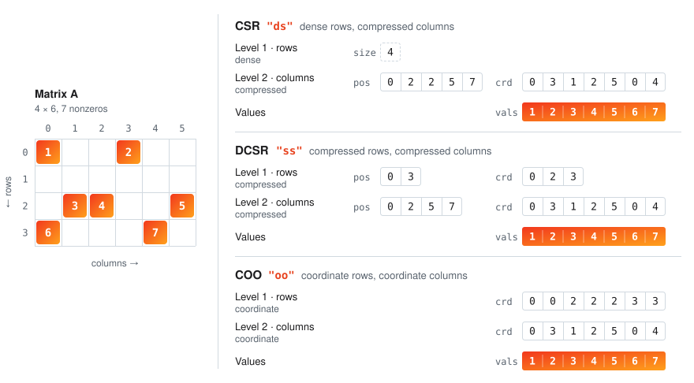
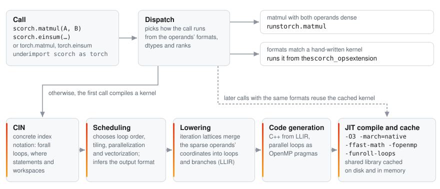

<div align="center">

<picture>
  <source media="(prefers-color-scheme: dark)" srcset="docs/source/_static/img/scorch-logo-dark.svg">
  
</picture>

<h3>A sparse tensor compiler for PyTorch</h3>

[](https://doi.org/10.1109/CGO68049.2026.11394842)
[](https://www.python.org/)
[](https://pytorch.org/)
[](#installation)
[](LICENSE)

[Installation](#installation) · [Quickstart](#quickstart) · [Formats](#storage-formats) ·
[How it works](#how-scorch-compiles-an-operation) · [Performance](#performance) ·
[Documentation](#documentation) · [Citation](#citation)

</div>

Scorch generates, compiles and caches a C++ kernel for each sparse tensor
operation and each combination of operand storage formats. It works on ordinary
PyTorch tensors: under `import scorch as torch`, `torch.matmul` and `torch.einsum`
run on Scorch, and every other name is PyTorch's own.

```python
import scorch as torch                    # torch.matmul and torch.einsum now run on Scorch

dense = torch.rand(4096, 4096)
A = torch.where(dense < 0.01, dense, 0.0).to_sparse_csr()   # a PyTorch CSR tensor, 1% nonzero
X = torch.rand(4096, 256)

Y = torch.matmul(A, X)                    # Scorch's CSR × dense kernel; Y is a torch.Tensor
```

Storage formats are part of the program. Each mode of a tensor is dense,
compressed or coordinate, and Scorch compiles a kernel for the combination it is
given:

```python
import scorch

A = scorch.from_torch(dense, "A").to_sparse("ss")    # DCSR: compressed rows and columns
Y = scorch.einsum("ij,jk->ik", A, X, format="dd")    # first call compiles a DCSR × dense kernel
```

- **Formats.** One letter per mode: `"ds"` is CSR, `"ss"` is DCSR, `"oo"` is COO,
  `"dd"` is dense. Operands of a call can have different formats.
- **Compiler.** Generic operations are lowered from concrete index notation through
  iteration lattices to C++ with OpenMP. Loop order, tiling and parallelization
  are chosen automatically, as described in the
  [CGO 2026 paper](#citation).
- **Hand-written kernels** serve the common `matmul` cases (CSR × dense, CSR × vector,
  CSR × CSR, COO × dense, COO × COO) without compiling anything.
- **Autograd.** Gradients flow through `matmul` for sparse × dense products, to the
  dense operand and to a sparse operand that requires grad.

> [!NOTE]
> Scorch is research software (version 0.0.1). Its kernels run on the CPU, on Linux
> and macOS. See [Current scope](#current-scope).

## Installation

Scorch builds from source. It needs Python 3.9 or newer (3.11 recommended), a C++
compiler with C++17 support, OpenMP and Ninja; `setup.sh` installs PyTorch and the
other Python dependencies.

```bash
git clone https://github.com/bobbyyyan/scorch.git
cd scorch
./setup.sh                    # macOS: run `brew install libomp` first
conda activate scorch         # or `source venv/bin/activate` when Conda is not installed
python scripts/verify_quickstart.py
```

`setup.sh` creates a Python 3.11 Conda environment named `scorch` (it first backs up
an existing environment of that name) or, without Conda, a `venv/` directory. It
then builds the native `scorch_ops` extension with an editable install.

<details>
<summary>Rebuild in an existing environment</summary>

```bash
python -m pip install -r requirements.txt
python -m pip install -e . --no-build-isolation
```

`--no-build-isolation` is required because the build imports `torch`. Rerun the
second command after editing anything under `src/scorch/csrc/`. The
[installation guide](docs/source/getting_started/installation.md) covers platform
details and troubleshooting.

</details>

## Quickstart

### Run existing PyTorch code on Scorch

`import scorch as torch` replaces two functions, `torch.matmul` and `torch.einsum`,
with Scorch's. Every other attribute is read from PyTorch, so the rest of the
program is unchanged. Operands stay `torch.Tensor`s, sparse or dense, and a dense
result comes back as a `torch.Tensor`.

```python
import scorch as torch

dense = torch.rand(4096, 4096)
A = torch.where(dense < 0.01, dense, 0.0).to_sparse_csr()
X = torch.rand(4096, 256)

Y = torch.matmul(A, X)                    # SpMM on Scorch
y = torch.matmul(A, X[:, 0])              # SpMV
C = torch.matmul(A, A)                    # SpGEMM, returns a sparse CSR tensor
```

`torch.mm`, `torch.sparse.mm` and the `@` operator are not replaced; they run
PyTorch's own kernels.

### Choose a storage format

`scorch.from_torch` wraps a tensor as an `STensor`, Scorch's tensor type, and
`to_sparse` converts it to a format. `einsum` takes any supported combination of
formats and an explicit output format:

```python
import torch
import scorch

dense = torch.where(torch.rand(4096, 4096) < 0.01, torch.rand(4096, 4096), 0.0)
X = torch.rand(4096, 256)

A = scorch.from_torch(dense, "A").to_sparse("ss")    # DCSR
print(A.format)                                       # s,s

Y = scorch.einsum("ij,jk->ik", A, X, format="dd")    # STensor with format d,d
assert torch.allclose(Y.to_torch(), dense @ X, atol=1e-3, rtol=1e-3)
```

The first call compiles the kernel. On an Apple M5 Max this script compiled two
kernels (the conversion to DCSR and the product) in 21 s with an empty cache; run
again, it took 1.0 s in total, because both kernels load from the on-disk cache.

### Train through a sparse product

```python
import scorch as torch

A = torch.where(torch.rand(4096, 4096) < 0.01, torch.rand(4096, 4096), 0.0).to_sparse_csr()
X = torch.rand(4096, 256, requires_grad=True)

loss = torch.matmul(A, X).square().sum()
loss.backward()                           # X.grad = 2 Aᵀ(A X), computed with Scorch's kernels
```

## Storage formats

A format gives one level type per tensor mode, outermost first. A dense level
stores nothing but its size. A compressed level stores, for each position of the
level above it, the range of its children (`pos`) and their coordinates (`crd`). A
coordinate level stores one coordinate per stored entry. The figure shows one
matrix stored three ways; the arrays are the ones Scorch builds for it.

<p align="center">
<picture>
  <source media="(prefers-color-scheme: dark)" srcset="docs/assets/readme/formats-dark.svg">
  
</picture>
</p>

| String | Level types | Common name |
|---|---|---|
| `"dd"` | dense, dense | dense matrix |
| `"ds"` | dense, compressed | CSR |
| `"ss"` | compressed, compressed | DCSR (doubly compressed) |
| `"oo"` | coordinate, coordinate | COO |

`s` and `c` are synonyms for compressed. A format can also be given as a list
(`["d", "s"]`) or a `scorch.TensorFormat`. `A.change_mode_order([1, 0])` stores a
CSR matrix by columns instead, which is CSC. The
[format guide](docs/source/user_guide/format_system.md)
covers constructors, conversion and mode orders. The `singleton` level type is
parsed but reserved: generated kernels support dense, compressed and coordinate
levels.

## How Scorch compiles an operation

<p align="center">
<picture>
  <source media="(prefers-color-scheme: dark)" srcset="docs/assets/readme/pipeline-dark.svg">
  
</picture>
</p>

1. **Dispatch.** A product of two dense tensors goes to `torch.matmul`. A `matmul`
   whose formats and dtype match a hand-written kernel in the `scorch_ops` extension
   runs that kernel. Everything else goes to the compiler.
2. **Concrete index notation.** The operation becomes a statement of `forall` loops,
   `where` statements and workspaces
   ([Kjolstad et al., CGO 2019](https://doi.org/10.1109/CGO.2019.8661185)).
3. **Scheduling.** Loop order, tiling, parallelization, vectorization and the output
   format are chosen by the heuristics in the CGO 2026 paper, which take
   milliseconds instead of a search over schedules.
4. **Lowering.** Iteration lattices
   ([Kjolstad et al., OOPSLA 2017](https://doi.org/10.1145/3133901)) merge the
   coordinates of the sparse operands into loops and conditionals.
5. **Code generation and caching.** The loops are emitted as C++ with OpenMP,
   compiled with `-O3 -march=native -ffast-math -funroll-loops -fopenmp`, and loaded
   as a shared library. The library is cached in memory and on disk (under
   `TORCH_EXTENSIONS_DIR`), so a later call with the same formats, including one in a
   new process, does not compile again.

This is the loop nest Scorch generated for the DCSR × dense product in the
quickstart (the branch for more than 8 columns, with the generated comments
removed):

```cpp
#pragma omp parallel for num_threads(scorch_nthreads(-1, pA0_end)) schedule(dynamic, scorch_chunk(pA0_end, -1))
for (int pA0 = A0_pos[0]; pA0 < pA0_end; pA0++) {
  int i = A0_crd[pA0];
  int pC0 = i;
  int pA1_end = A1_pos[pA0 + 1];
  for (int pA1 = A1_pos[pA0]; pA1 < pA1_end; pA1++) {
    if (pA1 + 1 < pA1_end) __builtin_prefetch(&B_val[A1_crd[pA1 + 1] * B1_size], 0, 1);
    int j = A1_crd[pA1];
    int pB0 = j;
    const float* __restrict__ _B_val_ptr = &B_val[pB0 * B1_size];
    for (int64_t k = 0; k < B1_size; k++) {
      int pC1 = pC0 * C1_size + k;
      C_values[pC1] += A_val[pA1] * _B_val_ptr[k];
    }
  }
}
```

The outer loop visits only the stored rows of `A` (its first level is compressed),
so empty rows cost nothing. For 8 or fewer columns the same kernel takes a second
loop nest that strip-mines `k` by 8 and accumulates each strip in a workspace held
in registers. The [compiler guide](docs/source/compiler/index.md) describes each
stage in detail.

## Operations

| Call | Computes | Notes |
|---|---|---|
| `scorch.matmul(a, b)` | SpMV, SpMM, SpGEMM, batched products | `torch.matmul` under the drop-in import. Returns a `torch.Tensor` for a dense result. |
| `scorch.einsum(expr, *operands, format=…)` | Contractions, elementwise products, SDDMM (`"ij,ik,kj->ij"`) | `torch.einsum` under the drop-in import. Needs an explicit output (`->`); returns an `STensor`. |
| `scorch.sparse_linear(x, weight, bias, activation)` | `F.linear` with a sparse weight | Bias and activation fused into the product. |
| `scorch.sparse_attention(crow, col, Q, K, V, scale)` | Multi-head attention masked by a CSR pattern | Fused; the mask is shared by all heads. |
| `scorch.sparse_softmax_csr(crow, values, scale)` | Row-wise softmax over the nonzeros of a CSR matrix | |
| `@scorch.compile` | Traces a function with `torch.fx` | Fuses a contraction with the elementwise operations after it. |
| `scorch.set_autotune(level)`, `scorch.autotune(level)` | Tiling selection for CSR × dense SpMM | Levels `off`, `analytic` (default), `balanced`, `max`, `learned`. |
| `scorch.set_num_threads(n)` | Thread count | Applies to PyTorch and to every Scorch kernel. |

The [API reference](docs/source/api/index.md) lists every public name.

## Performance

The [CGO 2026 paper](#citation) reports 1.05–5.80× speedups over PyTorch Sparse on
end-to-end graph neural network, sparse autoencoder and sparse transformer
workloads, measured on an Intel Core i9-14900K and an Apple M1 Ultra with the
paper's version of Scorch.

## Examples

| Example | Contents |
|---|---|
| [Kernels](examples/kernels/README.md) | SpMV, SpMM, SpGEMM and SDDMM on SuiteSparse matrices |
| [Graph convolutional network](examples/gcn/README.md) | GCN training and inference on Cora, Citeseer, PubMed and ogbn-arxiv, with PyTorch, PyG and DGL versions for comparison |
| [Sparse autoencoder](examples/sparse_autoencoder/README.md) | Autoencoders with sparse weights on MNIST, CIFAR-10, CIFAR-100 and CelebA |
| [Sparse transformer](examples/sparse_transformer/README.md) | BigBird-style sparse attention on IMDB, AG News and Yahoo Answers |

The benchmark harnesses for these workloads are in [`bench/`](bench);
[Benchmarks](docs/source/performance/benchmarks.md) lists them.

## Current scope

- Kernels run on the CPU: x86-64 and ARM64, Linux and macOS. Windows is not supported.
- `import scorch as torch` replaces `torch.matmul` and `torch.einsum` only.
  `torch.mm`, `torch.sparse.mm` and the `@` operator run PyTorch's kernels.
- `STensor` defines no `@` operator; call `scorch.matmul`.
- `einsum` needs an explicit output, as in `"ij,jk->ik"`.
- The first call for a new combination of operation, formats and dtype compiles
  C++, which takes several seconds. `scorch.precompile_kernels()` compiles the common
  SpMM and SpGEMM kernels ahead of time.
- The API can change between releases.

## Documentation

- [Getting started](docs/source/getting_started/index.md): installation, quickstart, key concepts
- [User guide](docs/source/user_guide/index.md): sparse tensors, formats, operations, neural-network layers, `scorch.compile`, autotuning
- [Compiler](docs/source/compiler/index.md): concrete index notation, lowering, workspaces, code generation
- [Performance](docs/source/performance/index.md): benchmarks and tuning
- [API reference](docs/source/api/index.md)

## Development

```bash
conda activate scorch
pytest tests                      # full suite; compiles kernels on first use
pytest -m "not perf"              # skip the performance tests
bash pre-commit.sh                # black, mypy, flake8
```

Tests compare every result with a PyTorch reference (`atol = rtol = 1e-3`). Kernels
are cached, so after changing code generation, point `TORCH_EXTENSIONS_DIR` at an
empty directory (the test suite does this) to make sure the change is compiled.

## Citation

If you use Scorch in your research, please cite the CGO 2026 paper:

> Bobby Yan, Alexander J. Root, Trevor Gale, David Broman, and Fredrik Kjolstad.
> Fast Autoscheduling for Sparse ML Frameworks. In *2026 IEEE/ACM International
> Symposium on Code Generation and Optimization (CGO)*, pages 28–43, 2026.
> [DOI](https://doi.org/10.1109/CGO68049.2026.11394842) ·
> [PDF](https://fredrikbk.com/publications/scorch.pdf)

```bibtex
@inproceedings{yan2026fast,
  author    = {Yan, Bobby and Root, Alexander J. and Gale, Trevor and Broman, David and Kjolstad, Fredrik},
  title     = {Fast Autoscheduling for Sparse {ML} Frameworks},
  booktitle = {2026 IEEE/ACM International Symposium on Code Generation and Optimization (CGO)},
  pages     = {28--43},
  year      = {2026},
  doi       = {10.1109/CGO68049.2026.11394842}
}
```

## License

Scorch is released under the [MIT License](LICENSE).
